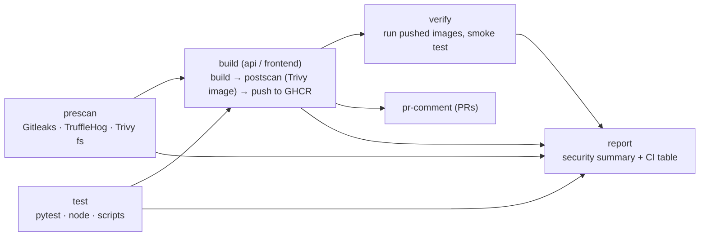

# Day 2 CI: PodPoll + security scanning

[](https://github.com/StargazerZX/day2-ci-assignment/actions/workflows/ci.yml)

A CI pipeline with security scanning (Gitleaks, TruffleHog, Trivy) built from **composite actions**,
around **PodPoll**: a small voting app (an nginx frontend and a Flask API) that shows which build, instance and
environment answered you. That makes pipeline changes visible in the browser. Plus [**labs**](labs/) that plant problems for
the scanners to catch.

## Run PodPoll locally

Docker with the Compose plugin is all you need.

```bash
local/up.sh dev        # http://localhost:8081  (also: prod :8082, staging :8083)
local/down.sh dev
```

Card 3 ("What's running?") shows the commit, build and CI system of each tier. Votes are kept in the API's
memory: restart it and they're gone (there is no database, on purpose).

## The pipeline (`.github/workflows/ci.yml`)



- **Triggers:** push to `main` (not for docs-only changes), pull requests to `main`, manual runs
  (`python-version`, `push-images`, `fail-on-findings`), and every Monday 07:00 UTC.
- **Scan before push:** each image is built on the runner, scanned by the **postscan** action, and pushed to
  `ghcr.io/<owner>/podpoll-<component>:sha-<commit>` only if it passed, and never from a pull request.
- **One security summary** per run (`report` job): every scanner in one table, suppressed findings included
  (`scripts/security-report.py`).

### The composite actions

| Action | Runs | Inputs |
|---|---|---|
| [`.github/prescan`](.github/prescan/action.yml) | Gitleaks + TruffleHog on the git history, Trivy on the files (vulnerable dependencies, secrets, Dockerfile misconfigurations) | `scan-path`, `fail-on-findings` (default `false`), `trivy-severity` (default `CRITICAL,HIGH`), `artifact-name` |
| [`.github/postscan`](.github/postscan/action.yml) | Trivy on a built image | `image-tag` (required), `fail-on-findings`, `trivy-severity`, `artifact-name` |

Both install their tools from the official releases after **verifying checksums**, upload the JSON reports even
when something is found, and write a summary table to the job summary. The scanning logic lives in the scripts
next to each `action.yml` (`scan.sh`, `scan-image.sh`), so `labs/scan-local.sh` runs exactly the same thing on
your machine. `fail-on-findings` is opt-in in the actions; this repository's workflow turns it on.

## Use it yourself (fork or copy)

1. **Fork** this repository (or create your own repository and push a copy of it).
2. In your repository: **Actions** tab → enable workflows. Everything runs in *your* repository, and images go to
   *your* GHCR namespace (`ghcr.io/<you>/podpoll-*`); nothing refers back to this one.
3. Push to `main` (or open a pull request into it) and watch the first run go green.
4. Do the [labs](labs/README.md): `labs/plant.sh 01` …

## Repository layout

```text
.github/prescan, .github/postscan   composite actions (+ their scan scripts)
.github/workflows/ci.yml            the pipeline
api/ frontend/                      PodPoll (each with a Dockerfile and tests)
local/                              Docker Compose stack: local/up.sh <env>
scripts/                            version.sh (build provenance), smoke-test.sh, security-report.py, tests
labs/                               the security labs
```

## Tests

```bash
scripts/test.sh          # API, scripts (security-report.py), frontend logic
```
